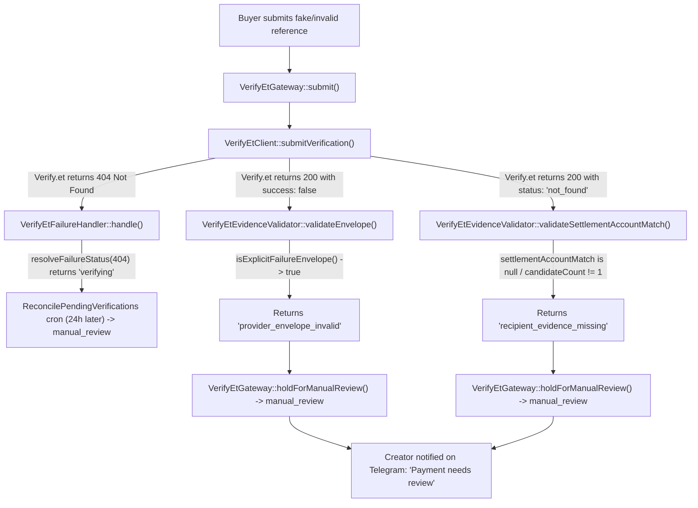

# Verify.et Integration Review: Settlement Account Matching & Manual Review Routing

This report analyzes the root cause of false/fake receipts improperly routing to `manual_review`, evaluates Verify.et's **Settlement Account Matching** feature, clarifies rate limit and transient failure behavior, and provides a precise architectural fix plan.

---

## 1. Executive Summary & Problem Definition

### The Bug / Unintended Behavior
When a buyer enters a fake reference, an invalid receipt number, or a non-existent transaction on the storefront checkout page:
1. The system flags the order as **`manual_review`** instead of rejecting it as a **`failed_verification` / `mismatch`**.
2. The checkout UI informs the buyer that their payment is *"under manual review by the creator"*, locking the checkout session.
3. The system triggers a Telegram notification to the creator via `CreatorPaymentReviewNotifier`, causing false alarms and creator fatigue.

### Core Principle
> **False, unverified, and non-existent receipts must NEVER fall under `manual_review`.**
> 
> * If a buyer submits an invalid or fake receipt, it is a **`mismatch`** (verification failure). It decrements the buyer's 5-attempt budget, keeps the order in `failed_verification` / `pending_payment`, and allows the buyer to re-enter their details until attempts are exhausted.
> * **`manual_review`** must be strictly reserved for verified payments with edge-case ambiguities (e.g. ambiguous creator accounts, post-verification fulfillment glitches, or creator allowance limits).

---

## 2. Root Cause Analysis in the Existing Codebase

Tracing how a false receipt progresses through Linket reveals four distinct code paths that inadvertently convert provider rejection into `manual_review`:



### Key Breakpoints in the Code

1. **`VerifyEtEvidenceValidator.php` (lines 402-417)**:
   ```php
   private function isExplicitFailureEnvelope(array $result, ?string $requestId): bool
   {
       if (array_key_exists('success', $result) && $result['success'] !== true) {
           return true; // <--- Traps terminal verification failures like not_found as corrupt envelope!
       }
   ```
   When Verify.et responds with `{"success": false, "error": {"code": "not_found"}}`, this helper treats the entire HTTP response as an invalid envelope (`provider_envelope_invalid`), causing `VerifyEtGateway::evaluateResultTransaction()` to invoke `holdForManualReview()`.

2. **`VerifyEtEvidenceValidator.php` (lines 113-132)**:
   ```php
   public function validateSettlementAccountMatch(mixed $match): ?string
   {
       if (!$this->matchBooleansArePresent($match)) {
           return 'recipient_evidence_missing';
       }
   ```
   If a transaction was not verified or not found, Verify.et does not supply a positive match (or supplies `matched: false`, `reason: "verification_not_successful"`). Linket treats this absence as a missing recipient proof on a presumed valid receipt, escalating to `manual_review`.

3. **`VerifyEtEvidenceValidator.php` (lines 266-279)**:
   ```php
   private function statusWithoutItem(array $result): string
   {
       // If data array is empty and status is not pending/queued:
       return 'manual_review';
   }
   ```
   A failed or unverified lookup returns an empty item list (`data: []`), falling directly into `manual_review`.

4. **`VerifyEtFailureHandler.php` (lines 49-60)**:
   ```php
   private function resolveFailureStatus(int $httpStatus): string
   {
       if (in_array($httpStatus, [400, 422], true)) {
           return 'mismatch';
       }
       if ($httpStatus === 409) {
           return 'manual_review';
       }
       return 'verifying'; // <--- HTTP 404 (not_found) stays in 'verifying' indefinitely!
   }
   ```
   If Verify.et returns HTTP 404 with `not_found`, it remains in `verifying` until the reconciliation cron triggers 24 hours later, turning it into `manual_review`.

---

## 3. Classification Taxonomy: Mismatch vs Verifying vs Manual Review

To ensure system integrity, states must be categorized by root intent:

| Category | Typical Provider Signals | System State | Order Status | Attempts Counted? | Notify Creator? |
| :--- | :--- | :--- | :--- | :---: | :---: |
| **False / Non-Existent Receipt** | `error.code: "not_found"`, `status: "not_found"`, `verified: false`, `reason: "verification_not_successful"` | `mismatch` | `failed_verification` | **Yes (1 attempt spent)** | **No** |
| **Wrong Recipient** | `matched: false`, `reason: "candidate_account_mismatch"` (buyer paid someone else) | `mismatch` | `failed_verification` | **Yes (1 attempt spent)** | **No** |
| **Wrong Amount / Currency** | `amount` does not match order, `currency` != ETB | `mismatch` | `failed_verification` | **Yes (1 attempt spent)** | **No** |
| **Invalid Buyer Formatting** | HTTP 422, `error.code: "invalid_input"`, bad suffix/phone | `mismatch` | `failed_verification` | **Yes (1 attempt spent)** | **No** |
| **Queued / Processing** | HTTP 202, `processingStatus: "queued"` or `"running"` | `verifying` | `verifying` | No | No |
| **Rate Limits (Throttling)** | HTTP 429, `upstream_rate_limited`, client rate limits | `verifying` (retry with backoff) | `verifying` | **No (do not penalize buyer)** | **No** |
| **Upstream Outage / Timeout** | HTTP 502, 503, 504, `upstream_timeout`, `upstream_unavailable` | `verifying` (retry / poll) | `verifying` | **No** | Admin alert only if persistent |
| **Ambiguous Creator Accounts** | `matched: false`, `ambiguous: true`, `reason: "ambiguous_registered_accounts"` | `manual_review` | `manual_review` | No | **Yes** |
| **Missing Settlement Registration** | Payment verified by bank, but `reason: "no_registered_accounts"` or `"missing_receiver_account"` | `manual_review` | `manual_review` | No | **Yes** |
| **Suspicious Duplicate Replay** | `confirmationHistory.confirmedBefore === true` across disparate buyer identities | `manual_review` | `manual_review` | No | **Yes** |
| **Creator Allowance Exhausted** | Payment verified, but creator free-tier quota is full | `manual_review` | `manual_review` | No | **Yes** |

---

## 4. Deep-Dive: Verify.et Settlement Account Matching

### Specification Overview
Settlement account matching validates that funds were deposited into the intended account, preventing cross-tenant fraud (e.g., using a valid receipt from an electricity bill or another creator's store to unlock digital downloads).

#### Request Contract
* **`settlementAccount` (optional string)**: The expected receiver account or phone number.
  * Linket currently supplies this on all requests from `$order->payment_account_snapshot` (`VerifyEtPayloadBuilder.php#L27`).
* **Fallback Behavior**: If omitted, Verify.et matches against registered business settlement accounts in the creator's Verify.et registry.

#### Response Object Contract (`settlementAccountMatch`)
```json
{
  "matched": true,
  "matchType": "masked_pattern",
  "matchConfidence": "high",
  "source": "account_registry",
  "bank": "telebirr",
  "receiverAccount": "2519****0897",
  "matchedSettlementAccount": "0939080897",
  "matchedUserBankAccountId": "58807b8e-ff38-49c9-a836-304c6b88bc29",
  "matchedBusinessBankAccountId": null,
  "candidateCount": 1,
  "ambiguous": false,
  "reason": "receiver_mask_matches_visible_digits",
  "debug": { ... }
}
```

### Analysis of the 8 Stable Reason Codes

| Stable Reason Code | Provider Meaning | Correct Linket Action | Current Linket Behavior | Gap / Fix Required |
| :--- | :--- | :--- | :--- | :--- |
| `receiver_account_exact_match` | Exact account number match | **Settle / Success** | Settle / Success | Working as intended |
| `receiver_mask_matches_visible_digits` | Masked digits match (e.g. `2519****0897` matches `0939080897`) | **Settle / Success** (if confidence high/exact) | Settle / Success | Working as intended |
| `receiver_suffix_matches` | Visible suffix matches | **Settle / Success** (if confidence high/exact) | Settle / Success | Working as intended |
| `candidate_account_mismatch` | Receipt is genuine, but paid to a different account | **Mismatch / Reject** (buyer paid wrong wallet) | Falls into `recipient_evidence_missing` -> `manual_review` | **Defect**: Must be `mismatch` (spend 1 attempt, do not notify creator) |
| `verification_not_successful` | Verification failed or receipt not found; cannot check receiver | **Mismatch / Reject** (invalid receipt) | Falls into `recipient_evidence_missing` -> `manual_review` | **Defect**: Must be `mismatch` (spend 1 attempt, do not notify creator) |
| `ambiguous_registered_accounts` | Multiple accounts match the masked pattern (`matched: false, ambiguous: true`) | **Hold for Manual Review** | `manual_review` | Working as intended |
| `no_registered_accounts` | Creator has no registered accounts for this bank | **Hold for Manual Review** + Creator alert | `manual_review` | Working as intended (creator must configure accounts) |
| `missing_receiver_account` | Provider omitted receiver info | **Hold for Manual Review** | `manual_review` | Working as intended |

---

## 5. Rate Limits & Transient Outages vs False Receipts

Rate limits and network timeouts represent infrastructure state, **NOT** buyer payment validity:

1. **Client Rate Limit (`verify-et:write`, 60/min)**:
   * Thrown by `VerifyEtClient::submitVerification()` with HTTP 429.
   * **Action**: Must remain in `verifying` with exponential backoff or return HTTP 429 to the client with `Retry-After`. The buyer's 5-attempt budget must **not** be decremented.
2. **Upstream Rate Limit (HTTP 429 from Verify.et)**:
   * Contains `Retry-After` header. Handled by client retries.
   * **Action**: If unrecoverable within the HTTP request cycle, leave verification in `verifying` for the background worker to poll. Never mark as `manual_review` or `failed_verification`.
3. **Upstream Timeouts (`upstream_timeout`, HTTP 504)**:
   * Provider bank gateway is slow.
   * **Action**: Verification stays in `verifying`. Webhook or background reconciliation will pick it up when the upstream bank responds.

---

## 6. Actionable Implementation Plan

To implement the correct behavior, the following adjustments are needed:

### Step 1: Fix Error Classification in `VerifyEtEvidenceValidator.php`
* Distinguish between **corrupt HTTP envelopes** and **legitimate provider negative outcomes**:
  * An envelope with `success: false` and `error.code: "not_found"` or `status: "not_found"` is a **valid provider response** representing a non-existent receipt. It should return a definitive `'not_found'` or `'mismatch'` signal, **not** `'provider_envelope_invalid'`.
* Update `statusWithoutItem()`:
  * If the response status is `'not_found'`, `'failed'`, or `error.code` is `'not_found'`, return `'mismatch'`, **never** `'manual_review'`.
* Update `validateSettlementAccountMatch()`:
  * If `$match['reason'] === 'verification_not_successful'`, return `'verification_not_successful'` (mapped to `mismatch`).
  * If `$match['reason'] === 'candidate_account_mismatch'`, return `'candidate_account_mismatch'` (mapped to `mismatch`).
  * Only return `'recipient_evidence_missing'` for true configuration/ambiguity gaps (`ambiguous_registered_accounts`, `no_registered_accounts`, `missing_receiver_account`).

### Step 2: Fix `VerifyEtFailureHandler.php`
* Update `resolveFailureStatus(int $httpStatus)`:
  * Include HTTP `404` in the mismatch list:
    ```php
    if (in_array($httpStatus, [400, 404, 422], true)) {
        return 'mismatch';
    }
    ```
  * Ensure provider error code `'not_found'` maps to `'mismatch'` regardless of status code.

### Step 3: Fix `VerifyEtGateway.php`
* In `evaluateResultTransaction()`:
  * Check for negative verification outcomes (`not_found`, `failed`, `verified === false`) and route them to `'mismatch'`:
    ```php
    if ($this->evidenceValidator->isDefinitiveNegativeResult($result, $item)) {
        $verification->update(['status' => 'mismatch', 'latest_error_code' => 'receipt_not_found']);
        if ($verification->payable_type === StorefrontOrder::class) {
            $order = StorefrontOrder::find($verification->payable_id);
            if ($order) {
                app(StorefrontVerificationSession::class)->recordMismatch($order, $verification);
            }
        }
        return 'mismatch';
    }
    ```
  * Only call `holdForManualReview()` when the error represents genuine ambiguity or system-level fulfillment failure.

### Step 4: Verification & Test Coverage
* Add unit/feature tests in `tests/Feature/VerifyEtDirectCheckoutTest.php`:
  * `test_false_receipt_reference_returns_mismatch_and_decrements_attempts()`
  * `test_candidate_account_mismatch_returns_mismatch_without_manual_review()`
  * `test_rate_limited_request_stays_verifying_without_decrementing_attempts()`
  * `test_ambiguous_settlement_match_holds_for_manual_review()`
